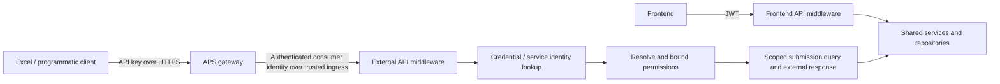

# External client API: working notes and implementation plan

Status: proposal for discussion; no runtime or gateway changes are implemented by this document.
Updated: 2026-11-05.

## Ticket and intended outcome

Epic: **External API**. Labels: `chefs2`, `P0`, `platform`, `api`, `security`.

As HMA, I want to pull my submission data into Microsoft Excel Power Query through a secure
CHEFS2 client API.

The initial idea is to put middleware between programmatic users holding API keys and the
application API. The frontend and programmatic clients should have separate API surfaces.
The gateway validates the API key and forwards a trusted identity. The backend finds that
identity's permissions, checks the endpoint and requested resources, and returns only the
data the client may access.

The two main design questions are:

1. How do we deploy and version the client API, including gateway configuration, through CI/CD?
2. How does a gateway-authenticated API key receive and exercise application permissions
   without exceeding the permissions of the person who generated it?

The CHEFS1 integration referenced by the ticket is the
[submission export operation](https://submit.digital.gov.bc.ca/app/api/v1/docs#tag/Submission/operation/export)
with `format=json`. Its documentation shell was reachable during research, but the operation
schema was not readable through the research tool. Capture a sample response and HMA's current
query before deciding which export behavior CHEFS2 must preserve.

Dependencies: API Gateway and API key issuance. Principal risks: unintended access to another
form or workspace, excessive delegated permissions, gateway bypass, and API misuse.

## What already exists in this repository

| Area | Current implementation | Consequence for this ticket |
| --- | --- | --- |
| API key management | [Credential issuer](credential-issuer.md): workspace/form credentials, APS consumer ID, creator, lifecycle state, one-time secret display, rotation and audit | Extend this lifecycle rather than build another key store |
| Incoming authentication | [Application mounts](../backend/src/app.ts) use JWT/IdP authentication for staff surfaces | Issuing a key does not yet let it authenticate to the backend |
| Gateway | [Proxy proof of concept](../deployments/gateway/README.md) maps a public host into `/chefs/api/v1`; its template configures no authentication plugins | A passing health check does not establish a secure external API |
| Authorization | [Workspace access model](workspace-access-model.md): group → role → permission, form overrides, permission-filtered lists | Reuse the permission catalog and resource/list scoping rules |
| Credential purpose | `api` and `web-component` types are metadata today | Neither type currently grants or enforces incoming access |
| Deployment | GitHub Actions build images and deploy Helm releases; PR, Dev and Test have gateway checks | Extend existing workflows with contract, authentication and routing validation |

Two gaps matter for an API key “user.” Group membership and permission resolution currently
operate on human `user` members, and workspace administration is separate from form RBAC.
A workspace admin may manage keys without having `submission_read`. Key-management permission
alone must therefore never authorize delegation of submission access.

## Proposed API separation

Start with a dedicated external router and authentication chain in the existing backend,
sharing services and repositories with the frontend API. Give the external surface its own
OpenAPI contract and explicitly allowed endpoints. Begin with read-only submission export.
An independent middleware service is an option if separate deployment or scaling becomes a
requirement; it is not necessary just to establish separate contracts.



The external middleware resolves identity and access; handlers call application services.
Avoid an unrestricted HTTP proxy into the frontend routes. A key must not gain access to
design, admin, key-management or submit routes by changing its URL.

### Proposed endpoint pattern

Illustrative public URLs; hostname and first supported major remain decisions:

```text
GET https://<external-api-host>/v2/forms/{formId}/submissions/export?format=json
GET https://<external-api-host>/v2.1/forms/{formId}/submissions/export?format=json
```

Proposed upstream mount: `/chefs/external/api/v2.1/...`, separate from the frontend's
`/chefs/api/v1/...`. The numbers in the public API, the frontend path, and the application
package version have independent meanings. CHEFS2 does not automatically require public API v2.

Define the export's JSON schema, status/date filters, stable ordering, page limits and cursor
behavior in OpenAPI. Scope every page and count before querying; apply an explicit external
field allowlist to the response. Do not include attachments, internal notes or internal metadata
unless they are part of the agreed contract and separately authorized where needed.

## Versioning and the gateway

Use semantic versions for external contract releases, with explicit gateway aliases:

| Public path | Proposed meaning | Example after releasing `2.2.0` |
| --- | --- | --- |
| `/v2` | Latest approved stable release within major 2 in that environment | `2.2.0` |
| `/v2.1` | Latest approved patch within minor 2.1 | `2.1.4` |
| `/v2.2` | Latest approved patch within minor 2.2 | `2.2.0` |
| `/v3` | Latest approved stable release within major 3; never a fallback for v2 | `3.0.0` when introduced |

These are deployment policies we implement, not a gateway feature that interprets semantic
version ranges. Kong supports path-based routing and path rewriting; confirm the actual APS
router version, permitted configuration and plugins in the gateway spike.
See [Kong routing documentation](https://developer.konghq.com/gateway/routing/traditional/).

Under [Semantic Versioning](https://semver.org/), incompatible contract changes require a major
release, backward-compatible additions a minor release, and compatible fixes a patch release.
Define compatibility for Excel specifically: JSON shape, names, types, nulls, paging and errors.
A change that breaks HMA's saved query must not silently move behind `/v2` as a minor release.

Recommendations:

- Keep `/v2.1` on the 2.1 contract after `/v2` advances. Explicit minor aliases create a support
  obligation: retain a handler/adapter or a maintained deployment for each supported minor.
- Prefer one current backend containing supported contract adapters, so older public contracts
  receive current authorization and security fixes. Use separate deployments only when needed.
- Keep full patch versions in release metadata; omit public patch URLs initially. A minor alias
  pins a contract line, not identical bytes forever.
- Route unknown versions to a documented error, without a catch-all fallback. Test boundaries
  such as `/v2`, `/v2.1`, `/v2.10`, `/v20` and trailing slashes against the deployed router.
- Publish a support and retirement policy before exposing minor pinning. Avoid per-minor branches
  unless a separately deployed implementation actually requires them.

### Proposed CI/CD flow

The release unit is the backend image digest, source commit, external OpenAPI contracts,
gateway configuration and alias mapping. Use a reviewed manifest to record that association.
Gateway configuration is version-controlled alongside the implementation; keys and individual
consumers stay in the existing credential lifecycle, outside static route manifests.

| Stage | Required work and release gate |
| --- | --- |
| Pull request | Validate OpenAPI; compare each supported contract with its released baseline; check the declared version change; test permissions, row/field scoping and gateway configuration rendering |
| Preview | Deploy isolated backend and gateway routes; verify real key authentication, spoofed-header rejection, forbidden resources and version routing; clean up with the PR |
| Build | Build immutable artifacts once and record their digests and source commit; render/validate the gateway config from that same commit |
| Dev | Deploy compatible schema changes and backend first; wait for readiness; dry-run then publish scoped gateway config; run authenticated export and negative tests |
| Test / UAT | Promote the tested artifacts and environment-specific mapping; run supported-version regression checks and HMA's actual Excel refresh |
| Production | Deploy compatible backend/schema, verify it, then update gateway aliases; probe every supported alias and permission boundary; record the deployed mapping and monitor errors/latency |
| Rollback | Restore the previous gateway mapping and compatible backend artifact as necessary; retain previous contracts/upstreams until verification completes |

Concrete workflow changes should extend `gateway-proxy-check.yaml` and the existing deployment
callers. Pass the exact source ref/release manifest to gateway publication: the current gateway
workflow checks out the workflow run's default ref rather than accepting an explicit release ref.
Do not assume its checkout always matches an explicitly selected backend release.

Serialize publication per gateway environment/configuration ownership boundary. Use stable
qualifiers so publishing one release cannot remove unrelated services or consumers. Confirm
APS dry-run, qualifier replacement and publication failure behavior before relying on them.
Treat application and gateway updates as separate operations with explicit recovery steps;
do not assume a cross-system atomic transaction. A failed gateway publish must leave the prior
working mapping usable. Database migrations must support the rollback window through additive
changes and delayed removal.

## Permission model for an API key “user”

The proposed model is sound: authenticate at the gateway, authorize in the application.
Represent each integration as a non-interactive service identity associated with its credential,
workspace, optional form, creator and selected groups. Keep it distinct from the creator's human
identity for audit, revocation and to prevent interactive login or platform-admin inheritance.

Implement the smallest explicit extension to existing group membership and permission resolvers
that can represent this service identity, including form overrides. Current resolvers cannot
accept a credential ID in place of a user ID. Settle the schema in a short design decision before
implementing; avoid parallel role/permission catalogs or fake IdP accounts.

### Issuing and changing a credential

1. Authenticate the human and check the existing permission to manage keys in the target scope.
2. Validate the requested groups, workspace and optional form server-side. Resolve their actual
   permission codes and resource coverage, including overrides. Group names or workspace-admin
   status are insufficient evidence of authority to delegate.
3. Require the requested grant to be a subset of the creator's effective access on every resource
   it covers. For workspace-wide grants, include overridden forms; new forms must be bounded at
   request time as well. Reject overbroad requests rather than silently trimming them.
4. Persist selected groups, explicit delegated permission ceiling and resource scope. Expand `*`
   to the currently allowed concrete permission codes; do not give keys future permissions
   automatically when the catalog or group roles change.
5. Reserve the credential/service identity and issue through the existing adapter. Activate it
   only when ownership, consumer mapping and grants are persisted successfully. Preserve existing
   reconciliation for ambiguous outcomes. Return the raw key once.
6. Apply the same delegation checks to grant edits, group assignment changes and ownership
   transfer. Existing keys receive no external access until explicitly configured and authorized.

For the initial read-only export, the delegation ceiling and endpoint allowlist need only
`submission_read`; add other existing permission codes only when a new endpoint requires them.

### Request-time flow

1. Gateway validates the key and applies rate limits and any coarse service ACL.
2. Backend verifies that the request came through the trusted gateway channel, then reads the
   authenticated consumer ID. Map `(environment, gateway/issuer identity, consumer ID)` to the
   locally owned credential/service identity; the environment/channel context is server-trusted.
   Unknown consumers are refused. Forwarding the creator's user ID would impersonate the human
   and lose the credential's individual scope.
3. Require an active, non-deleted credential and active service identity, with purpose permitted
   for this external surface. Reject unresolved lifecycle states. Check expiry if supported.
4. Resolve the requested form/submission to its actual workspace. Enforce the credential's
   workspace and optional form scope before resolving its current group permissions.
5. Compute the effective grant per resource:

   ```text
   current service-identity group permissions, including form overrides
     ∩ explicit delegated permission ceiling
     ∩ creator's current effective permissions
     ∩ credential resource scope
     ∩ permissions supported by this external API surface
   ```

6. Check the endpoint's required codes, then pass the resulting resource grant to the data query.
   Reuse the existing filtered-list approach so pagination and totals obey the same grant.
7. Serialize only contracted fields and record credential identity, scope, operation, outcome
   and request ID. Keep raw keys and submission contents out of logs.

Recommended policy: the key remains bounded by its creator's current permissions. Losing a
permission or leaving the workspace removes delegated access on subsequent requests. A creator's
later promotion or a group's expansion cannot exceed the explicit ceiling. A durable integration
that must survive staff departure needs an explicit, authorized ownership-transfer procedure.
This ongoing ceiling is a recommendation beyond the ticket's minimum creation-time requirement.

Start without cross-request permission caching. Resolve access on every export page; define a
bounded recheck/cancellation policy if asynchronous export jobs are added. If caching is introduced,
document its revocation delay and invalidation behavior.

### Trust boundary and lifecycle requirements

[Kong Key Auth](https://developer.konghq.com/plugins/key-auth/) documents consumer and credential
identity headers, including `X-Consumer-ID` and `X-Credential-Identifier`. Confirm the headers and
consumer-ID correspondence produced by our APS issuance flow in the deployed environment.
The Kong credential identifier is distinct from the application's credential record ID.

Gateway-supplied headers are trustworthy only over an authenticated/restricted channel. Strip or
overwrite client-supplied identity headers, reject anonymous fallback, and hide the raw key from
upstream requests. A direct caller must not be able to forge a consumer ID. Because the frontend
still reaches this backend through another public route, a namespace NetworkPolicy alone does not
protect an external router on the same exposed listener. Choose and test an isolated gateway-only
listener/service or cryptographically authenticated gateway assertions; the frontend ingress must
not provide a bypass. Express `trust proxy` and CORS do not authenticate gateway identity.

Gateway ACLs may restrict which API service a consumer can invoke. Application group permissions
remain authoritative for workspace/form/submission access. Do not forward a permission list in
headers and accept it without local authorization.

Keep existing rotation/audit behavior. Locally inactive, deleted or unresolved credentials must
fail closed even if APS still recognizes a key. Verify that rotation invalidates the old key and
that the consumer mapping remains correct. APS deletion currently rotates/discards the key rather
than removing the consumer; gateway changes and ambiguous outcomes need explicit reconciliation.

## Excel / Power Query validation

Proposed request shape, not a validated integration:

```http
GET /v2.1/forms/<form-id>/submissions/export?format=json
Host: <external-api-host>
X-API-Key: <key supplied through the chosen credential mechanism>
Accept: application/json
```

`X-API-Key` is a proposed header name; configure and verify the same name in APS and the client.
[Web.Contents](https://learn.microsoft.com/en-us/powerquery-m/web-contents) supports custom headers,
but its `ApiKeyName` option places the key in a URL query parameter. It does not directly solve
secure header-based key storage. Microsoft's
[connector authentication guidance](https://learn.microsoft.com/en-us/power-query/handling-authentication)
shows credential-store access for custom connectors; establish whether that approach is supported
and deployable in HMA's actual Excel environment before committing to it.

Make client authentication an early feasibility gate. Record HMA's Excel edition/platform,
interactive or scheduled refresh needs, credential storage and workbook-sharing behavior. A key
hard-coded in M or a workbook parameter does not establish secure credential storage. If the
target Excel setup cannot securely supply the chosen header, resolve the authentication design
before building the export contract around it.

Validation evidence must include initial import and saved-workbook refresh, complete multi-page
retrieval with expected row counts, null/date/nested-field behavior, empty results, rate limits,
rotation, revocation, and refusal of another form/workspace. Use non-production test submissions;
store a redacted query/template and test results without a key. No live APS authentication or
Excel validation was performed while writing this proposal.

## Implementation plan and acceptance tracking

| Order | Work package | Completion evidence |
| --- | --- | --- |
| 1 | Gateway and Excel feasibility spike: actual APS key flow, headers, spoof prevention, router behavior, qualifiers, Excel credential storage and representative CHEFS1 export | Redacted working request, observed routing/header results, and a proven credential approach for HMA's Excel |
| 2 | Record design decisions: first major/hostname, alias semantics, supported-version lifetime, gateway trust channel, service-identity schema and creator-loss policy | Reviewed decisions and external OpenAPI draft |
| 3 | Extend existing credential lifecycle with service identities, selected groups, ceilings and scope validation; update management UI using backend permission results | Tests reject escalation, cross-workspace groups, wildcard expansion and unauthorized grant edits; UI offers authorized actions |
| 4 | Add external router and trusted-gateway middleware; adapt existing RBAC/grant resolution and implement scoped, paged JSON export | Backend tests cover overrides, list totals, resource/field boundaries, state changes and direct-ingress/header attacks |
| 5 | Extend CI/CD with immutable release manifests, compatibility checks, gateway promotion and rollback | Preview-to-Test demonstration of `/v2` advancement, `/v2.1` retention, `/v3` isolation and rollback without loss of auth controls |
| 6 | Validate with HMA, publish client docs and operational runbook, then release | Redacted Excel evidence, supported endpoint/version table, rotation/revocation procedure and monitored rollout |

| Ticket acceptance criterion | Deliverable | Current state |
| --- | --- | --- |
| External endpoint pattern documented | Proposed pattern above; finalized OpenAPI and client guide in packages 2 and 6 | Proposed |
| Example integration validated | Real HMA Excel import/refresh evidence in packages 1 and 6 | Pending |
| Middleware accepts gateway identity, translates permissions and scopes data | Trusted channel plus backend authorization and filtered queries in package 4 | Proposed |
| Key generation creates an identity with group permissions no greater than the generator's | Service identity and delegation validation in package 3, with request-time ceiling in package 4 | Proposed |
| Investigate semantic versioning with API Gateway | Alias policy and CI/CD design above; APS routing and promotion proof in packages 1 and 5 | Design documented; deployed behavior unverified |

Decisions still open: public hostname/initial major; minor-version support duration; service-identity
schema; exact trusted-ingress mechanism; whether to adopt the ongoing creator ceiling; and HMA's
supported Excel authentication/refresh approach. These need resolution before their dependent
implementation work, but do not prevent starting the feasibility spike.
