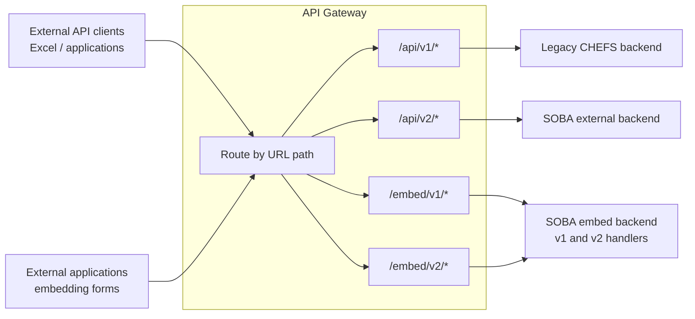

# Gateway routing for external APIs and embedded forms

Proposed routing: one public gateway sends requests to a backend based on the URL path.
API clients and applications embedding forms use different routes through the same gateway.

| Public route | Destination |
| --- | --- |
| `/api/v1/*` | Legacy CHEFS backend |
| `/api/v2/*` | SOBA external backend |
| `/embed/v1/*` | SOBA embed backend, v1 handler |
| `/embed/v2/*` | SOBA embed backend, v2 handler |

`*` represents the rest of the request path. The gateway can rewrite the public path to match
the backend's internal path. Additional embed versions can be added as they become supported.

API and embed routes can have separate authentication and rate-limit rules. Each backend still
checks the caller's permissions for the requested forms and data.

The backend blocks show their responsibilities; they do not require a separate OpenShift
deployment for every route. For example, both embed versions can run in one deployment.
This diagram proposes routing only; it does not implement the gateway configuration or change
existing legacy CHEFS URLs.

Related: [versioning options](external-api-versioning-options.md) and
[external API design](external-api-design.md).
